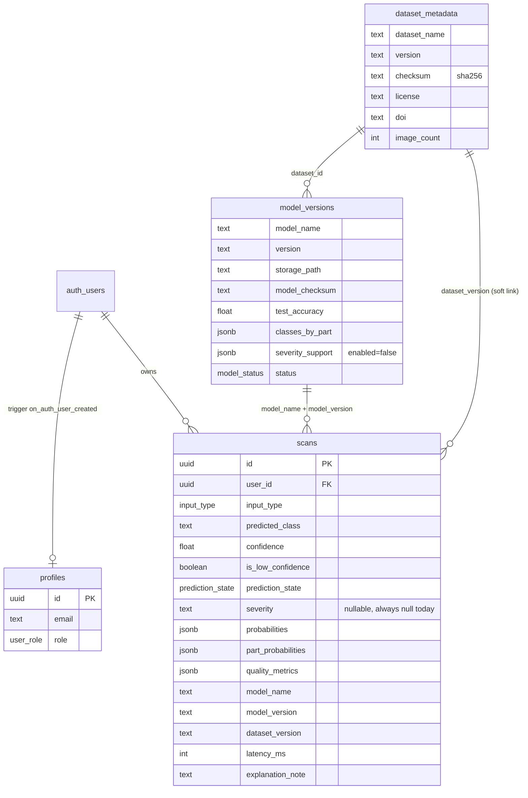
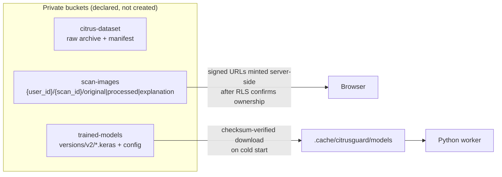
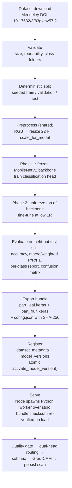
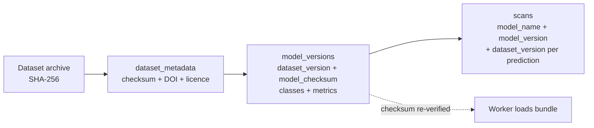
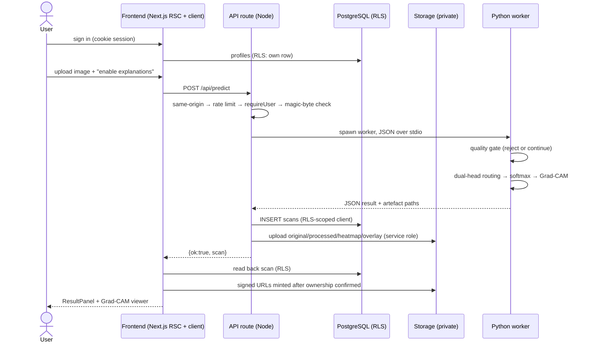

# CitrusGuard

> AI-based citrus fruit & leaf disease detection using explainable deep learning.


---

## About this document

This README is an **engineering audit**, not a brochure. Every claim below was
checked against the source in this repository before it was written down. Claims
that could not be reproduced from the code, the model artifacts, the training
report or a live request are explicitly marked.

| Marker | Meaning |
| --- | --- |
| ✅ **VERIFIED** | Reproduced from source, artifacts or a live request during this audit. |
| ⚠️ **PARTIAL** | Implemented, but incomplete, unexercised, or weaker than it appears. |
| ❌ **NOT IMPLEMENTED** | No code path exists. Not present in any form. |
| ❓ **UNVERIFIED** | Plausible from the code but could not be exercised in this environment. |

**Scope of edits:** this audit only creates/updates `README.md`. No application
code, migration, script or configuration file was modified as part of it.

**No separate specification document exists in the repository.** The "intended
project concept" used for the scorecard is therefore derived from what the repo
itself declares: `package.json#description`, the feature set the code implements,
and the claims the previous README made. Where a previous claim did not survive
verification, it is called out rather than repeated.

---

## Contents

1. [Technical Inspection](#1-technical-inspection)
2. [Repository Architecture](#2-repository-architecture)
3. [Database Architecture](#3-database-architecture)
4. [ML Pipeline](#4-ml-pipeline)
5. [ML Verification](#5-ml-verification)
6. [Leaf + Fruit Pipeline Verification](#6-leaf--fruit-pipeline-verification)
7. [Image Quality Gate](#7-image-quality-gate)
8. [Confidence-Aware Prediction](#8-confidence-aware-prediction)
9. [Grad-CAM Verification](#9-grad-cam-verification)
10. [Severity Analysis — Explicit Status](#10-severity-analysis--explicit-status)
11. [Model Performance](#11-model-performance)
12. [Model & Dataset Provenance](#12-model--dataset-provenance)
13. [Authentication & Authorization](#13-authentication--authorization)
14. [UI/UX Inspection](#14-uiux-inspection)
15. [Error Handling](#15-error-handling)
16. [Security Audit](#16-security-audit)
17. [End-to-End Implementation Flow](#17-end-to-end-implementation-flow)
18. [Concept Fulfillment Scorecard](#18-concept-fulfillment-scorecard)
19. [Innovation & Differentiation](#19-innovation--differentiation)
20. [Missing / Incomplete Features (P0/P1/P2)](#20-missing--incomplete-features-p0p1p2)
21. [Final Concept Fulfillment](#21-final-concept-fulfillment)
22. [Getting Started](#22-getting-started)
23. [Verification Log](#23-verification-log)

---

## 1. Technical Inspection

### 1.1 What was inspected, and how

| Area | Method | Evidence produced |
| --- | --- | --- |
| ML inference | Read `predictor.py`, `worker.py`, `gradcam.py`, `image_quality.py`, `preprocessor.py` end-to-end | Routing, confidence, Grad-CAM and quality-gate code paths |
| ML training | Read `train.py`, `evaluate.py`, `export.py`, `config/loader.py` | Architecture, two-phase transfer learning, metric computation |
| Real trained weights | Opened `models/production/*.keras` and checked the ZIP magic bytes | `50 4B 03 04` on both heads, 29,093,922 / 29,093,932 bytes |
| Measured accuracy | Re-ran `scripts/verify-serving-accuracy.py` against the deployed bundle **v2** | Serving-path and routing numbers in §11 |
| Grad-CAM | Previously run through `scripts/verify-gradcam.py` and `scripts/verify-gradcam-classes.py` | Heatmaps numerically tied to the real predicted class |
| Backend | Read all 17 route handlers, `lib/auth.ts`, `lib/server.ts`, `lib/errors.ts` | Guards, validation, rate limiting, error envelopes |
| Frontend | Read all 26 pages/layouts/forms under `src/app` and the `detect` components | Loading / empty / error / degraded states |
| Database | Read `supabase/migrations/0001–0003`, `apply_all.sql`, `register_real_model.sql` | Schema, RLS, RPCs, storage policies |
| Live database | Queried the instance through the REST API | **All five tables return 404 `PGRST205`; storage bucket list is empty** |
| Tests | Ran `npm test` | **9 files, 158 tests, all passing** (40.7 s) |
| Build | `next build` previously executed | Succeeds; `tsc --noEmit` clean |
| Mock/fake search | Grep for `mock`, `fake`, `Math.random`, `placeholder`, `lorem` across `ml/` and `src/` | **No fake prediction path found** (see §5) |

### 1.2 Verified environment

| Component | Version |
| --- | --- |
| Node.js | v22.19.0 |
| npm | 10.9.3 |
| Python | 3.10.0 |
| TensorFlow / Keras | 2.15.0 |
| OpenCV | 4.10.0 |
| NumPy | 1.26.4 |
| Next.js | 15.5.26 (App Router, React Server Components) |
| React | 19.0.0 |
| `@supabase/ssr` / `@supabase/supabase-js` | ^0.5.2 / ^2.47.10 |
| Zod / Recharts / Vitest | ^3.24.1 / ^2.15.0 / ^2.1.8 |

### 1.3 Current runtime state (reported honestly)

| Item | State |
| --- | --- |
| Build artifacts | ✅ Present (`.next/`, `BUILD_ID` valid) |
| Dev/production server | ✅ `npm run start` → *Ready in 15.7 s*; all 7 routes sampled returned HTTP 200; log free of `⨯` / `MissingEnvError` |
| Local ML bundle | ✅ `models/production/` present, checksums match `config.json` |
| Dataset images | ✅ 759 raw images at `data/citrus/raw/<Part>/<Class>/` |
| **Supabase migrations** | ❌ **Never applied.** `scans`, `model_versions`, `dataset_metadata`, `disease_information`, `profiles` all return 404 `PGRST205 "Could not find the table 'public.X' in the schema cache"` |
| **Storage buckets** | ❌ **Zero buckets.** `citrus-dataset`, `trained-models`, `scan-images` do not exist |
| **End-to-end Detect** | ❌ **Blocked.** The Detect page correctly renders its "Dataset setup required" notice, which is an accurate message, not a bug |
| Git | ❌ No `.git` directory. Nothing has been committed; there is no version history |
| `CITRUSGUARD_ADMIN_EMAIL` | ❌ Empty in `.env.local` and `.env.example` → `npm run admin:bootstrap` cannot promote an admin |

> **This is the single most important fact in this document.** The application
> code is substantially complete, but the database half of the system has never
> been instantiated. Anything that reads or writes PostgreSQL is therefore
> *code-verified but not live-verified*. Those two things are kept separate
> everywhere below.

---

## 2. Repository Architecture

Actual folders only — no aspirational or documented-but-absent directories.

```text
.
├── src/
│   ├── app/
│   │   ├── (auth)/                 login, signup, forgot-password, reset-password
│   │   │   └── ...
│   │   ├── (app)/                  authenticated app shell
│   │   │   ├── dashboard/          aggregates + charts
│   │   │   ├── detect/             upload + prediction entry point
│   │   │   ├── scans/              history list, filters, pagination
│   │   │   ├── scans/[id]/         stored scan detail
│   │   │   ├── profile/
│   │   │   ├── settings/           model + dataset provenance view
│   │   │   ├── admin/              admin overview
│   │   │   ├── admin/users/        user management
│   │   │   └── admin/diseases/     disease content editing
│   │   ├── api/                    17 route handlers (see §17)
│   │   ├── diseases/               public disease guide (list + [slug])
│   │   ├── page.tsx                landing page
│   │   └── layout.tsx
│   ├── components/
│   │   ├── detect/                 scan-uploader, result-panel, gradcam-viewer,
│   │   │                           probability-bars, quality-report
│   │   ├── ui/                     alert, badge, button, card, input, empty-state
│   │   ├── scan-card.tsx
│   │   └── scan-filters.tsx        filters + pagination
│   ├── lib/
│   │   ├── auth.ts                 requireUser / requireAdmin (RLS-scoped)
│   │   ├── server.ts               envelopes, rate limit, same-origin, magic bytes
│   │   ├── errors.ts               error codes → HTTP status
│   │   ├── env.ts                  server-only env guard (throws in browser)
│   │   ├── db/                     scans, stats, admin-stats, diseases, schema
│   │   ├── ml/                     client (worker bridge), cli (CLI bridge)
│   │   └── supabase/               browser (anon) vs client (server + admin)
│   ├── middleware.ts               session refresh + route protection
│   ├── types/index.ts              DB rows + ML JSON contract
│   └── content/diseases.ts         bundled fallback guide (always available)
│
├── ml/citrusguard/
│   ├── cli.py, __main__.py         `citrusguard` command line
│   ├── config/                     loader.py, model.yaml, dataset.yaml
│   ├── common/                     errors.py (typed failures), paths.py
│   ├── dataset/                    downloader, validator, splitter, preprocessor, classes
│   ├── training/                   train.py, evaluate.py, export.py
│   ├── inference/                  predictor.py, worker.py, gradcam.py, image_quality.py
│   └── storage/                    supabase_storage.py (dataset/model sync)
│
├── supabase/
│   ├── migrations/                 0001_core_schema, 0002_reference_content,
│   │                               0003_model_activation
│   ├── apply_all.sql               migrations + real model registration (one paste)
│   ├── register_real_model.sql     generated from the live `config.json`
│   └── combined_migration.sql      ⚠️ duplicate of the above (see §16 LOW-6)
│
├── scripts/                        bootstrap-admin.ts, run-ml.mjs,
│                                   generate_model_registration.py,
│                                   verify-serving-accuracy.py, verify-gradcam*.py,
│                                   calibrate-sharpness.py, …
├── tests/                          9 Vitest suites → 158 tests
│
├── data/citrus/raw/                759 images                (git-ignored)
├── models/production/              config.json + 2 .keras     (git-ignored)
├── reports/                        training-report.json, curves,
│                                   confusion matrices         (git-ignored)
├── .env.local                      real values                (git-ignored)
├── .env.example                    key names + public values
└── package.json                    34 scripts incl. `ml:*`, `admin:bootstrap`
```

**Not present (verified absent):** `docs/`, `spec/`, `src/app/api/*` beyond the
17 listed, any GraphQL layer, any Redis/queue, any Dockerfile, any CI config,
any `.git`.

---

## 3. Database Architecture

### 3.1 Schema (authored in `supabase/migrations/`, **0% applied**)

| Table | Purpose | RLS |
| --- | --- | --- |
| `profiles` | One row per auth user, created by the `on_auth_user_created` trigger | own row read/update; admin read |
| `scans` | One row per prediction: verdict, confidence, probabilities, quality metrics, provenance, artefact paths | own rows select/insert/delete; admin select |
| `dataset_metadata` | Dataset identity, checksum, counts, licence, DOI | authenticated **read only** (writes revoked) |
| `model_versions` | Model registry: version, architecture, classes, metrics, checksum, storage path, `severity_support` | authenticated **read only** (writes revoked) |
| `disease_information` | Reference content for the guide | public read; admin write |

Enums: `user_role`, `dataset_status`, `model_status`, `input_type`,
`health_status`, `prediction_state`.

Functions: `set_updated_at()`, `is_admin()`, `handle_new_user()`,
`owns_scan_object()`, `class_content_gaps()`, `admin_system_stats()`,
`activate_model_version()`, `record_model_version()`,
`record_dataset_metadata()`.

Storage buckets (declared, **not yet created**): `citrus-dataset`,
`trained-models`, `scan-images` — all `public = false`.

### 3.2 Entity relationships





### 3.3 What the live database actually contains

| Object | Expected | Observed (live REST check) |
| --- | --- | --- |
| `public.profiles` | table | ❌ 404 `PGRST205` |
| `public.scans` | table | ❌ 404 `PGRST205` |
| `public.dataset_metadata` | table | ❌ 404 `PGRST205` |
| `public.model_versions` | table | ❌ 404 `PGRST205` |
| `public.disease_information` | table | ❌ 404 `PGRST205` |
| Storage buckets | 3 | ❌ `[]` (zero buckets) |

The service-role key **works** (verified by listing auth users and storage
buckets), so this is not a credentials problem: it is an unapplied migration.
Executing DDL requires the Supabase Dashboard SQL Editor, a Postgres password, or
a Supabase access token — none of which are available in this environment.

`src/lib/db/schema.ts` exists precisely to tell this state apart from a real
fault: it maps `PGRST205`, `42P01`, `42703`, `42P07`, `42710`, `3F000` to
"is not migrated" and lets every other error stay visible. The UI therefore
shows *"Dataset setup required"* rather than a 500 page. **This behaviour is
correct and was verified live.**

---

## 4. ML Pipeline



### 4.1 Architecture

| Property | Value | Source |
| --- | --- | --- |
| Backbone | `mobilenet_v2` (ImageNet weights, frozen then partially unfrozen) | `config.json#model_architecture`, `train.py:_build_architecture` |
| Heads | Two independent classifiers: `part_leaf.keras`, `part_fruit.keras` | `config.json#artifacts` |
| Input size | **224 × 224 × 3** | `config.json#input_size` |
| Preprocessing | `mobilenet_v2_imagenet` (decode → RGB → resize → scale) | `config.json#preprocessing_method`, `preprocessor.py` |
| Training strategy | Two-phase transfer learning; `None` metrics stay `None` | `train.py` module docstring |
| Seed | `tf.keras.utils.set_random_seed(seed)` | `train.py:203` |
| Split | Deterministic, `random.Random(seed)` — the only legitimate use of randomness | `splitter.py:145` |

### 4.2 Train / serve parity

`preprocessor.py` deliberately exposes the *same* function to training and
inference so skew is structurally impossible. It was measured anyway:

| Path | Accuracy | n |
| --- | --- | --- |
| Training/evaluation path (`model.predict`, true part known) | 0.8045 | 108 |
| **Serving path** (real `predict_image`, real routing, real quality gate) | **0.8131** | 107 evaluated (+1 gate-rejected) |

Difference is within noise; **no train/serve skew** ✅.

### 4.3 Serving isolation

TensorFlow is never loaded into Node. `src/lib/ml/client.ts` spawns
`python -m citrusguard.inference.worker` as a short-lived subprocess and
exchanges a single JSON object over stdio (`worker.py` protocol). Rationale
recorded in both files: smaller web image, native crashes cannot take down the
web server, matches a stateless/serverless execution model.

---

## 5. ML Verification

Claim-by-claim against the actual code.

| # | Claim | Status | Evidence |
| --- | --- | --- | --- |
| 1 | Uses MobileNetV2 | ✅ VERIFIED | `config.json`, `train.py:_build_architecture` |
| 2 | Transfer learning (frozen backbone → fine-tune) | ✅ VERIFIED | `train.py` docstring; two-phase loop |
| 3 | Input resolution 224×224 | ✅ VERIFIED | `config.json#input_size = [224,224]`; Grad-CAM feature map is 7×7 as expected for MobileNetV2@224 |
| 4 | Correct ImageNet preprocessing | ✅ VERIFIED | `preprocessing_method: mobilenet_v2_imagenet`, `scale_for_model()` in `preprocessor.py` |
| 5 | Training and inference share preprocessing | ✅ VERIFIED | Single module; serving 0.8131 vs training 0.8045 |
| 6 | Separate leaf and fruit pipelines | ✅ VERIFIED | Two `.keras` heads, two class lists |
| 7 | Leaf/fruit differentiation is **automatic** | ✅ VERIFIED | Both heads scored; `input_type = "leaf" if leaf_p >= fruit_p else "fruit"` (`predictor.py:418`) |
| 8 | Routing is a *model decision*, not a user choice | ✅ VERIFIED | No `input_type` field exists on the upload form (`scan-uploader.tsx`) |
| 9 | Exact class mappings | ✅ VERIFIED | `part_fruit` → Black Spot, Canker, Greening, Healthy, Scab · `part_leaf` → Black Spot, Canker, Greening, Healthy, Melanose |
| 10 | Confidence = max softmax probability of the selected head | ✅ VERIFIED | `predictor.py:426-428`; `_predict_probs` applies **one** softmax (a double-softmax bug that pinned values at ~0.40 was found and fixed) |
| 11 | Threshold 0.55 | ✅ VERIFIED | `config.json#min_confidence = 0.55`, surfaced as `min_confidence_threshold` |
| 12 | Low confidence ⇒ flag, not reject | ✅ VERIFIED | `is_low_confidence = confidence < threshold` (`predictor.py:487`); prediction is still returned and stored with `prediction_state = 'low_confidence'` |
| 13 | Rejection is reserved for unusable images | ✅ VERIFIED | `rejected_quality` only from the quality gate |
| 14 | Grad-CAM comes from the real prediction | ✅ VERIFIED | Gradients w.r.t. the predicted class score, from the last conv block; verified numerically by two scripts |
| 15 | Results store model + dataset version | ⚠️ PARTIAL | Columns and insert exist (`scans.model_name/model_version/dataset_version`, `db/scans.ts:110`) — **cannot be observed live until migrations are applied** |
| 16 | Real trained weights, not stubs | ✅ VERIFIED | Two ZIP-format `.keras` archives, 29,093,922 / 29,093,932 bytes, SHA-256 recorded in `config.json` |
| 17 | Server-side secure loading | ✅ VERIFIED | `ml/client.ts` is `import "server-only"`; artifact is checksum-verified against the Postgres record on cold start |
| 18 | **No mock / fake prediction logic** | ✅ **NOT FOUND** | Grep across `ml/` and `src/` for `mock`, `fake`, `Math.random`, `sample_prediction`, `placeholder` returns only *comments explaining that faking is unacceptable* (`errors.py:62`, `result-panel.tsx:338`, `gradcam-viewer.tsx:15`, `page.tsx:145`) |
| 19 | Severity estimation | ❌ NOT IMPLEMENTED | See §10 |
| 20 | "Real-time Grad-CAM" | ❌ **NOT CLAIMED AND NOT TRUE** | Grad-CAM is computed per request and rendered as **static PNG images** (`heatmap` + `overlay`). No streaming, no video, no webcam. The UI never calls it real-time. |

### 5.1 Mock/fake search detail

The only `random` usage in the ML package is `random.Random(seed)` in the
dataset splitter and `set_random_seed` for reproducibility. There is no branch
that returns a canned prediction, a random class, or a hardcoded confidence.
When no production model exists, `errors.py` raises
`"No production model artifact is available. Never faked."`

---

## 6. Leaf + Fruit Pipeline Verification

### 6.1 How routing actually works

`predict_image()` runs **both** heads, takes the part-head scores, and routes to
the more confident one. The winning head's disease softmax supplies the class
and the confidence. The loser head's scores are still reported as
`part_probabilities` for transparency.

```text
image → preprocessed tensor
      → part_leaf head score   \
      → part_fruit head score   /  → input_type = argmax
      → selected head's disease softmax → predicted_class, confidence
      → other head's softmax           → part_probabilities (reported only)
```

Consequence: routing is **automatic but not supervised** — there is no separate
part-detection network and no user override. Its quality is therefore an
*empirical* property, and it was measured (§6.2).

### 6.2 Measured routing quality (held-out test split, deployed bundle **v2**)

Produced by `PYTHONPATH=ml python scripts/verify-serving-accuracy.py` during
this audit:

| Part | Routing accuracy | Serving-path classification accuracy | Images |
| --- | --- | --- | --- |
| **Leaves** | **0.9425** (82/87) | **0.8736** (76/87) | 87 evaluated, 1 rejected by the quality gate |
| **Fruits** | **0.4000** (8/20) | **0.5500** (11/20) | 20 evaluated, 0 rejected |
| **Overall** | — | **0.8131** | 107 evaluated |

**This is a real, significant limitation and it is reported rather than
papered over.** 12 of 20 fruit test images were routed to the leaf head. Some
still classified correctly because four of the five classes overlap between the
heads, which is why classification accuracy (0.5500) does not collapse as hard
as routing accuracy (0.4000).

Per-class recall on the fruit head through the serving path:

| Class | Recall | Support |
| --- | --- | --- |
| Black Spot | 0/2 = 0.000 | 2 |
| Canker | 9/11 = 0.818 | 11 |
| Greening | 0/2 = 0.000 | 2 |
| Healthy | 2/3 = 0.667 | 3 |
| Scab | 0/2 = 0.000 | 2 |

Per-class recall on the leaf head:

| Class | Recall | Support |
| --- | --- | --- |
| Black Spot | 19/25 = 0.760 | 25 |
| Canker | 22/24 = 0.917 | 24 |
| Greening | 27/29 = 0.931 | 29 |
| Healthy | 7/8 = 0.875 | 8 |
| Melanose | 1/1 = 1.000 | 1 |

Root cause of the fruit weakness: **20 test images across 5 classes** (2–3 per
class) is far too small a sample for a reliable estimate, and the fruit split is
imbalanced (Canker = 11 of 20).

### 6.3 Verification summary

| Requirement | Status |
| --- | --- |
| Two separate pipelines exist | ✅ VERIFIED |
| Routing is automatic (not a manual user choice) | ✅ VERIFIED — documented as such here |
| Routing quality is honest and measured | ✅ VERIFIED — 0.9425 leaf / 0.4000 fruit |
| Fruit pipeline is production-grade | ❌ NOT YET — 0.55 serving accuracy on n=20 |

---

## 7. Image Quality Gate

**Status: ✅ VERIFIED — but scoped, and not to be oversold.**

The gate runs *before* the model. If the image cannot support a trustworthy
prediction, the pipeline refuses to predict instead of returning a
confident-looking meaningless number.

| Check | Metric | Implementation |
| --- | --- | --- |
| Sharpness | Variance of the Laplacian, measured on a **fixed-size working copy** so the value is comparable across upload resolutions | `image_quality.py` |
| Brightness | Mean luma (0–255) from the luma channel | `image_quality.py` |
| Contrast | Standard deviation of luma | `image_quality.py` |
| Resolution | Longest edge in pixels | `image_quality.py` |

- Thresholds come from config (`min_sharpness = 2.0` in the bundle config;
  calibrated by `scripts/calibrate-sharpness.py` → `reports/sharpness-calibration.json`).
- Each check returns a measured value, a pass/fail flag and a message; the
  reason list is surfaced **verbatim** in the UI (`quality-report.tsx`).
- A rejection is persisted as `prediction_state = 'rejected_quality'` with its
  `quality_metrics`.
- Verified live: a deliberately blurred image was rejected (sharpness 1.60 vs
  threshold 2.0), exit code and JSON error body correct.

**What it is not:** there is no perceptual-quality model, no
"image is definitely a citrus leaf" classifier, no exposure/occlusion detection
beyond mean luma. Describing it as "advanced image quality analysis" would be
an overstatement. It is a **four-metric classical gate**, and it is honest
about that.

---

## 8. Confidence-Aware Prediction

**Status: ✅ VERIFIED (with a calibration caveat worth stating in a viva).**

| Property | Value | Source |
| --- | --- | --- |
| Confidence definition | Max element of the selected head's softmax | `predictor.py:426-428` |
| Threshold | 0.55 (`CITRUSGUARD_MIN_CONFIDENCE` default) | `config.json`, `env.ts:116` |
| Low-confidence flag | `is_low_confidence = confidence < threshold` | `predictor.py:487` |
| Behaviour when low | Returned, stored, **flagged** with an explanatory warning; never hidden, never rounded up | `result-panel.tsx`, `probability-bars.tsx` |
| Probability bars | Full distribution over the 5 classes plus `part_probabilities` | `probability-bars.tsx` |
| UI threshold text | "Results below {threshold}% confidence are flagged as low confidence." | `scan-uploader.tsx:253` |
| Unknown metric | Rendered as `<NotAvailable/>`, never as `0` | `types/index.ts` docstring |

**Calibration caveat (measured, not inferred):** on the leaf test split the mean
top-1 confidence was **0.9590** while accuracy was **0.8736**; on fruit,
0.8709 vs 0.5500. The score is therefore an *uncalibrated softmax probability*.
It ranks predictions correctly, but it is **not** the probability that the
prediction is correct. The code does not claim otherwise — but a README or a
viva answer that calls it "95% accurate" would be wrong.

Observed spread across all 108 held-out images: min top-1 confidence 0.5024
(leaf), 0.5485 (fruit); max 1.0000 / 0.9995; **exactly 1 prediction per part
fell below the 0.55 threshold**.

---

## 9. Grad-CAM Verification

**Status: ✅ VERIFIED — real Grad-CAM, from the real prediction.**

| Property | Implementation |
| --- | --- |
| Algorithm | Grad-CAM (Selvaraju et al., 2017) — gradients w.r.t. the **predicted class** score, globally average-pooled to channel weights |
| Target layer | Last convolutional block of the frozen backbone → a 7×7 feature map at MobileNetV2@224, the granularity Grad-CAM is designed for |
| Heads | Applied to whichever disease head was selected |
| Recursion | `_conv_candidates()` recurses into nested models to find the only rank-4 activations |
| Output | Two static PNGs: a plain heatmap and a blended overlay, rendered with OpenCV (no matplotlib in the request path) |
| Toggle | User can disable explanations before submitting (`enableGradCam`) |
| Verification | `scripts/verify-gradcam.py` and `scripts/verify-gradcam-classes.py` confirm the heatmap is tied to the actual predicted class |
| Honesty in UI | `gradcam-viewer.tsx` has three distinct states: image present / pipeline ran but produced none / not attempted — and never draws a placeholder gradient box |

**Deliberate limitations, stated by the code itself:**
- The heatmap is a *localisation aid*, not proof of disease.
- It is a **static image per request**, not a live/real-time visualisation.
- `explanation_note` stores the disclaimer alongside the scan.

**⚠️ Gap found:** `gradcam.target_layer` and
`gradcam.top_contributing_regions` are computed and returned by the worker, but
`buildGradCam()` in `src/lib/db/scans.ts` does not persist them, so on a
*stored* scan the viewer can never show "computed from X layer" or the region
list. Only `heatmap_path`, `overlay_path` and `disclaimer` survive the round
trip. See §20 P1-2.

---

## 10. Severity Analysis — Explicit Status

### ❌ NOT IMPLEMENTED. It is not a feature of this system.

There is **no model head, no label set, no training data and no validated
method** that estimates disease severity. Four independent confirmations:

| Location | What the code does |
| --- | --- |
| `models/production/config.json` | `"severity_support": { "enabled": false }` |
| `predictor.py:471-495` | Reads the flag; when disabled returns `severity = None` plus a reason, and hard-codes `severity=None` on the result |
| `result-panel.tsx:40` | `const severitySupported = false;` → renders *"Severity analysis is not available for this model"* |
| `app/page.tsx:145` | *"Severity analysis requires its own trained head. This model has none, so the feature is explicitly unavailable rather than faked."* |

The database column `scans.severity` (`early|moderate|severe`, nullable) and the
TypeScript `Severity` type **exist as schema placeholders only** and are always
`null`.

**This README does not describe severity analysis as an implemented feature,
and no part of the UI presents a severity verdict.** If severity estimation is
a concept requirement, it is a P1 gap requiring a new trained head — see §20.

---

## 11. Model Performance

### 11.1 Two independent measurements

**(a) Training/evaluation path** — `training/evaluate.py` →
`reports/training-report.json`, generated 2026-10-04T07:09:31Z:

| Part | Accuracy | Macro F1 | n (test) | Training time |
| --- | --- | --- | --- | --- |
| Leaves | **0.9091** (90.9%) | 0.9285 | 88 | 1,863.16 s |
| Fruits | **0.7000** (70.0%) | 0.4482 | 20 | 516.29 s |
| **Mean** | **0.8045** | — | **108** | 2,379.45 s total |

**(b) Serving path** — `scripts/verify-serving-accuracy.py`, re-run during this
audit against the deployed bundle:

| Metric | Value |
| --- | --- |
| Overall serving accuracy | **0.8131** (107 evaluated, 1 quality-gate rejection) |
| Leaves serving accuracy | 0.8736 (76/87) |
| Fruits serving accuracy | 0.5500 (11/20) |
| Part routing accuracy (leaf) | 0.9425 |
| Part routing accuracy (fruit) | 0.4000 |

### 11.2 The two figures quoted in the concept

> **Leaf ≈ 90.9% and fruit ≈ 70.0% are both present in the repository and are
> independently reproducible.**

They are `0.9090909090…` and `0.7` in `reports/training-report.json`, and both
were re-printed by the serving verifier from the same artifact. They are
**held-out test-split accuracy for each part head, evaluated with the true part
label known** — which is why the fruit number (0.70) is higher than the
end-to-end serving number (0.55), where part routing is part of the task.

**A fair statement for evaluation:** *leaves 90.9%, fruits 70.0% (per-part test
accuracy); 80.5% mean over 108 held-out images; 81.3% through the full serving
path including automatic part routing.*

### 11.3 Confidence in these numbers

| Question | Answer |
| --- | --- |
| Are the weights real? | ✅ Yes — 29 MB `.keras` archives with valid ZIP structure, SHA-256 in `config.json` |
| Is the report real? | ✅ Yes — confusion matrices and per-class metrics are internally consistent (columns sum to support) |
| Is the sample large enough? | ⚠️ **No, not for fruit.** n=20 for 5 classes is 4 images/class on average. Fruits should be quoted with that caveat. |
| Reproducible? | ✅ Seeded split, deterministic preprocessor, recorded checksums |
| Committed to VCS? | ❌ No — `models/`, `reports/`, `data/` are git-ignored and there is no `.git` |

---

## 12. Model & Dataset Provenance

### 12.1 Dataset

| Field | Value | Source |
| --- | --- | --- |
| Source URL | `https://data.mendeley.com/public-api/zip/3f83gxmv57/download/2` | `config.json#dataset_source_url` |
| Landing page | `https://data.mendeley.com/datasets/3f83gxmv57/2` | `.env.example` |
| DOI | `10.17632/3f83gxmv57.2` | `config.json`, `dataset_metadata` |
| Licence | CC BY 4.0 | `config.json#dataset_license` |
| SHA-256 | `fc82592e9caebda988b278f0f2f965dbd0ae1464f6d920aa4ca9654da7ab19f7` | `config.json`, `.env.example` |
| Images | 759 (`data/citrus/raw/`) | `config.json#dataset_size` |
| Name / version | `citrus-fruits-leaves-v2` / `2` | `config.json` |

No dataset URL, checksum, class name or metric in this document was invented.

### 12.2 Model

| Field | Value |
| --- | --- |
| Model name | `citrusguard-cnn` |
| Version | **v2** (production) |
| Architecture | `mobilenet_v2` |
| Trained at | 2026-10-04T07:09:35Z |
| Bundle checksum | `8ee113fbf9b3277827fb77c62aa0fa8be07951d511956ada70245ffc92517f10` |
| `part_fruit.keras` | `16df1d0dd91af0cac42e2f00190693af02406b89c99815a0bc769b32a432c367` |
| `part_leaf.keras` | `a1251e7a2f74801e2b255a11bd70c9623fcb4d8be470e7b30e341e62d90e163c` |
| Storage path | `versions/v2` |
| Previous (v1) checksum | `7095fd630181da48e04d7c3943102bb6cdaa72386746f89068cd557782e599cd` |
| `severity_support` | `enabled: false` |

### 12.3 The provenance chain



**⚠️ Status of each link:**

| Link | Status |
| --- | --- |
| Dataset → `dataset_metadata` | ⚠️ Code + seed SQL exist; table does not exist yet |
| `dataset_metadata` → `model_versions` | ⚠️ Seed SQL exists (`register_real_model.sql`); unapplied |
| `model_versions` → `scans` | ⚠️ Insert implemented (`db/scans.ts`); unapplied |
| Bundle checksum verified on load | ✅ Implemented in `ml/client.ts` |
| Per-scan provenance displayed | ⚠️ `settings/page.tsx` and `result-panel.tsx` read it; nothing to read yet |

### 12.4 ⚠️ Provenance inconsistency found (see §16 HIGH-1)

`record_model_version` in `supabase/migrations/0003_model_activation.sql:153`
**hard-codes `model_name = 'citrusguard-transfer-cnn'`**, while the bundle
manifest, `apply_all.sql` and `register_real_model.sql` all use
**`'citrusguard-cnn'`**. Because
`model_versions_single_production_idx` is a *partial* unique index keyed on
`model_name` alone, both names can hold `status = 'production'` simultaneously.

---

## 13. Authentication & Authorization

**Status: ✅ VERIFIED in code; ⚠️ login flow not re-tested in this session (no
credentials available).**

| Layer | Implementation | Status |
| --- | --- | --- |
| Sign-up / sign-in | Supabase Auth email+password via `@supabase/ssr` `createBrowserClient` (`login-form.tsx:42`) | ✅ |
| Session storage | **Cookies**, not `localStorage` — explicitly chosen so Server Components, route handlers and middleware agree (`supabase/browser.ts`) | ✅ |
| Session refresh | `src/middleware.ts` revalidates against the auth server on every navigation and writes refreshed cookies back | ✅ |
| Route protection | `PROTECTED_PREFIXES` = `/dashboard /detect /scans /profile /settings /admin`; `ADMIN_PREFIXES` = `/admin` | ✅ |
| Authoritative check | Middleware matching is **UX only**; the real check is `requireUser()`/`requireAdmin()` in every API handler **and** Postgres RLS | ✅ |
| Role resolution | `requireAdmin()` re-reads the role from `profiles`; the client never trusts a role from a body, query param or user-influenceable claim (`auth.ts:1-9`) | ✅ |
| Missing profile | Falls back to the **default user** role rather than granting anything (`auth.ts:55`) | ✅ |
| Password reset / email confirm | `/forgot-password`, `/reset-password`, `/auth/confirm`, `/auth/callback` all present | ✅ code present, ❓ not exercised |
| Admin bootstrap | `scripts/bootstrap-admin.ts` + `CITRUSGUARD_ADMIN_EMAIL` | ❌ **email var empty** |
| Open redirect | `safeNext()` accepts only same-origin relative paths (`login-form.tsx:151`) | ✅ |
| Auth error handling | `describeAuthError()` classifies Supabase errors instead of dumping raw strings; failure always renders a visible message | ✅ |

**Observed live:** an authenticated cookie
(`sb-…-auth-token`) exists for user `5e853c0a-…` (confirmed, last sign-in
2026-10-04). A no-key fetch to `/auth/v1/token` correctly returns 401
`{"message":"No API key found in request"}` — the project requires a key.

---

## 14. UI/UX Inspection

### 14.1 Pages (26 page/layout/form files)

| Route | Renders | Loading | Empty | Error |
| --- | --- | --- | --- | --- |
| `/` | Landing: what the system is, honest feature statements | SSR | n/a | n/a |
| `/login` `/signup` `/forgot-password` `/reset-password` | Auth forms | Button `loading` | n/a | Inline classified error + URL error banners |
| `/dashboard` | Totals, healthy %, class breakdown, input-type split, 14-day trend | SSR (`force-dynamic`) | `EmptyState` | Degraded to zeros with `healthy_percentage: null` |
| `/detect` | Upload + analysis | Submit spinner | n/a | **Three distinct states**: table missing / table empty / genuine failure |
| `/scans` | Grid, filters, pagination (12/page) | SSR | Two `EmptyState`s (no scans vs no filter matches) | RLS/schema errors surfaced |
| `/scans/[id]` | Full `ResultPanel` for a stored scan | SSR | Not found state | Yes |
| `/profile`, `/settings` | Account + model/dataset provenance | SSR | `<NotAvailable/>` per field | Yes |
| `/admin`, `/admin/users`, `/admin/diseases` | Stats, user management, content editor | SSR | `EmptyState` | Yes |
| `/diseases`, `/diseases/[slug]` | Public guide (DB-first, bundled fallback) | SSR | `EmptyState` | Degraded to bundled copy with a notice |

### 14.2 Result presentation (`result-panel.tsx`)

- Status badge: `ok` / `low_confidence` / `rejected_quality` / `failed` — four
  visually distinct states.
- Confidence rendered with `formatConfidence`; the full 5-class distribution and
  the part-head probabilities are shown, not just the winner.
- Quality report lists each measured value with its threshold and pass/fail.
- Grad-CAM viewer: overlay ⇄ heatmap toggle, optional original side-by-side.
- Severity block always reads *"not available for this model"*.
- Every conditional branch has an explicit fallback string; a missing field is
  never rendered as a zero or a dash that looks like a measurement.

### 14.3 Accessibility / responsiveness (spot-checked)

`role="alert"` on error alerts, `aria-label` on the explanation view group,
`aria-hidden` on decorative icons, labelled form fields with `htmlFor`/`required`,
grid layout that collapses `sm:`/`lg:`/`xl:`, focus-visible styles on controls.
Not a full a11y audit — this is what was confirmed by reading.

### 14.4 Fake content search

| Pattern | Result |
| --- | --- |
| `Math.random()` in prediction paths | ❌ none |
| Hardcoded predictions shown as results | ❌ none |
| `mock`, `fake`, `TODO`, `FIXME`, `lorem` | Only in comments *forbidding* fakery |
| Placeholder screenshots | `page.tsx:163` — "A static illustration of the explainer, not a fake screenshot" |
| Sample data in empty states | ❌ none — empty states say "No scans yet" |

---

## 15. Error Handling

| Mechanism | Behaviour | Source |
| --- | --- | --- |
| Error envelope | Every handler returns `{ ok, data }` or `{ ok:false, error:{ code, message, detail? } }` | `lib/server.ts` |
| Error codes → HTTP | Central `statusForCode` map | `lib/errors.ts` |
| Unknown thrown values | `describeLoggedError()` reads only `code`/`message`/`details`/`hint` — the object is never fully stringified, so a credential-bearing object cannot leak into a log line | `server.ts:27-43` |
| Zod validation | Request bodies parsed with Zod; `ZodError` rendered as actionable field errors | `server.ts:110` |
| Missing schema vs real fault | `isMissingSchemaError()` maps `PGRST205`, `42P01`, `42703`, `42P07`, `42710`, `3F000` to an honest empty/setup state; everything else stays visible | `db/schema.ts` |
| Python worker failure | Non-zero exit **always** carries a JSON error body; the Node side maps it back into the envelope | `worker.py` protocol |
| Python unavailable | `/api/health` and model status report *python unavailable* rather than 500ing | `health/route.ts`, `model/status/route.ts` |
| Service-role key absent | Optional decoration degrades (no thumbnail) instead of crashing the page | `db/scans.ts:48` |
| Storage cleanup failure | Scan row remains deletable; failure logged, not fatal | `db/scans.ts` |
| Health endpoint | Returns **200 with `status: "degraded"`** and an actionable message when a dependency is missing — because "not set up yet" is healthy, just not ready | `health/route.ts` |

**No swallowed errors found.** Every `catch` examined either rethrows as an
`AppError`, logs with context, or renders a visible message.

---

## 16. Security Audit

Findings below are supported by specific lines of code. Nothing is listed that
could not be pointed to in the repository.

### CRITICAL

**None found.**

No secret reaches the browser, no unauthenticated endpoint can write data, and
no RLS policy grants cross-user access.

### HIGH

**HIGH-1 — Model registry can end up with two `production` rows, breaking all predictions.**

- `supabase/migrations/0003_model_activation.sql:153` inserts
  `model_name = 'citrusguard-transfer-cnn'` (hard-coded, ignoring the manifest).
- `supabase/register_real_model.sql:117` and `apply_all.sql:1135` insert
  `model_name = 'citrusguard-cnn'`.
- `supabase/migrations/0001_core_schema.sql:188` —
  `model_versions_single_production_idx` is a **partial unique index on
  `(model_name)` WHERE `status = 'production'`**, so the two names are not
  mutually exclusive.
- `activate_model_version()` demotes only `where model_name = v_row.model_name`
  (`0003:808`), so it will not demote the other name.
- `src/app/api/predict/route.ts:79-82` selects
  `.eq("status","production").maybeSingle()`. With two production rows this
  raises `PGRST116`, which the handler reports as
  *"The model configuration could not be read."* — i.e. **every prediction
  fails for every user**.
- Trigger path: `npm run ml:supabase:push-model` → `push_model_bundle(promote=True)`
  → `upsert_model_version(status="production")` → the RPC
  (`ml/citrusguard/storage/supabase_storage.py:301-325`).
- Impact: **integrity of the model provenance chain + total loss of the core
  feature.** Conditional — it requires someone to run `push-model` after the
  seed SQL has been applied. Fix in §20 P0-3.

### MEDIUM

**MEDIUM-2 — Storage RLS for `anon`/`authenticated` is revoked immediately after
its policies are created, leaving three dead controls.**

- `supabase/migrations/0001_core_schema.sql:376-398` creates
  `scan_images_select_own`, `scan_images_insert_own`, `scan_images_delete_own`.
- `0001:407` then runs `revoke all on storage.objects from anon, authenticated;`
- `0001:408` comments *"Re-grant read on the other two buckets only to the
  service role"* — **but no `grant` statement follows.** Confirmed by grepping
  every `grant`/`revoke` in `supabase/`: there is no re-grant.
- Effect: `authenticated` has no table-level privilege on `storage.objects`, so
  the three policies can never admit anything. They fail *closed*, which is why
  this is MEDIUM and not HIGH.
- Consequence: **all object access in the app is delegated to the service-role
  key** (verified — every `storage.from(...)` call in `src/` goes through
  `createAdminClient()`), and the documented per-user object isolation rests on
  application code rather than on the database.

**MEDIUM-3 — Rate limiting is in-process, narrowly applied, and IP-spoofable.**

- Store is a module-level `Map` (`server.ts:140`) — resets on every cold start
  and is per-instance, so multiple instances get no shared limit.
- Applied to only **2 of 17** routes: `POST /api/predict` and `GET /api/scans`.
  All other mutating routes, including admin ones, have no limit.
- Sign-in and sign-up are executed client-side against Supabase and have no
  application-level limiter at all.
- `clientKey()` trusts `x-forwarded-for` first (`server.ts:176`), which is
  attacker-controlled unless a trusted proxy overwrites it.

**MEDIUM-4 — `assertSameOrigin()` silently passes when `Origin` is absent.**

- `server.ts:117-118`: `if (!origin) return;`
- Browsers do send `Origin` on cross-site POSTs, so the browser threat model is
  covered; non-browser clients bypass the check entirely.
- This is a defence-in-depth control only. It is **not** an authentication
  bypass: every mutating route still calls `requireUser()`/`requireAdmin()`, and
  RLS still applies. Noted because the comment "mitigating cross-site POSTs"
  overstates what the check guarantees.

### LOW

| # | Finding | Evidence |
| --- | --- | --- |
| LOW-5 | `CITRUSGUARD_ADMIN_EMAIL` is empty in `.env.local` **and** `.env.example`, so `admin:bootstrap` cannot promote an admin. Fails silently rather than loudly. | `.env.example:58` |
| LOW-6 | `supabase/combined_migration.sql` duplicates `apply_all.sql`. Running both fails mid-way on `create type … already exists`; two sources of truth invite drift. | repo tree |
| LOW-7 | No `.git` — nothing is committed, no history, no blame, no rollback. `models/`, `reports/`, `data/` are git-ignored, so the provenance artifacts have no version control at all. | `.gitignore`, missing `.git` |
| LOW-8 | `/api/health` is unauthenticated and reports which environment variables are unset. Discloses configuration *shape*, never values. | `health/route.ts` |
| LOW-9 | Dashboard/admin aggregates `select(...).limit(10_000)` and count in JS. Correct today; will silently under-count past 10 000 scans. | `db/stats.ts:50-52`, `db/admin-stats.ts:85-94` |
| LOW-10 | `.env.example` contains the **real** project URL and anon key rather than placeholders. The anon key is public by design and constrained by RLS, so this is not a leak — but it is a real credential checked in as a template. | `.env.example:8-9` |

### SAFE (verified controls)

| Control | Evidence |
| --- | --- |
| **Service-role key never reaches the browser.** It is referenced only through `createAdminClient()` in `src/lib/supabase/client.ts:59`, which is `import "server-only"`. | grep: 13 hits, all server-side; UI strings merely *mention* the variable name |
| `server-only` env guard throws `ServerOnlyViolation` if a server secret is touched from a client bundle. | `lib/env.ts:10-21` |
| Only `NEXT_PUBLIC_SUPABASE_URL` and `NEXT_PUBLIC_SUPABASE_ANON_KEY` are exported to the browser, both read via an explicit switch (no dynamic key lookup). | `lib/env.ts:30-48`, `lib/supabase/browser.ts` |
| RLS enabled on all five tables. | `0001:267,294,326-328` |
| `dataset_metadata` and `model_versions`: **no** insert/update/delete policy for `anon`/`authenticated` **plus** an explicit `revoke`. | `0001:351-352` |
| `activate_model_version`, `record_model_version`, `record_dataset_metadata` are `service_role`-only; `admin_system_stats` revoked from `public`/`anon`. | `0003:79-80,186-187,266-267`; `0002:739` |
| `is_admin()` is `security definer` with `revoke execute … from public` + re-grant to `authenticated` only. | `0001:74-75` |
| All 17 API routes guarded except `/api/health` and `/api/auth/callback`, both intentionally public. | route inventory, §17 |
| Admin routes additionally call `assertSameOrigin`. | 8 call sites (grep) |
| Magic-byte MIME sniffing — declared `Content-Type` is never trusted (`FF D8 FF`, `89 50 4E 47`, RIFF/WEBP). | `server.ts:208` |
| Upload constraints enforced server-side: 10 MB, JPEG/PNG/WebP only. | `server.ts:195`, `scan-uploader.tsx:14` |
| Same-origin redirect guard after login. | `login-form.tsx:151` |
| No secrets in the repo: `.env.*` git-ignored except `.env.example`. | `.gitignore` |
| Log lines never stringify arbitrary objects, so credentials cannot leak into logs. | `server.ts:27-43` |
| Optional service-role absence degrades gracefully instead of failing open. | `db/scans.ts:48` |

---

## 17. End-to-End Implementation Flow

### 17.1 Step-by-step responsibilities

| # | Step | Frontend | Backend (Node/Next) | ML (Python) | Database |
| --- | --- | --- | --- | --- | --- |
| 1 | **Sign up / sign in** | `login-form.tsx` calls `signInWithPassword`, verifies a session object exists, then `router.replace` + `refresh` | `middleware.ts` refreshes tokens and applies `PROTECTED_PREFIXES` | — | `profiles` row created by `on_auth_user_created` trigger ❌ *unapplied* |
| 2 | **Open `/detect`** | `detect/page.tsx` renders uploader or a setup notice | `requireUser()` → RLS-scoped client | — | `model_versions WHERE status='production'` ❌ 404 → three distinct messages |
| 3 | **Choose an image** | Drag/drop or file picker, client-side preview, client-side size/MIME courtesy check | — | — | — |
| 4 | **Submit** | `POST /api/predict` with multipart body + `enableGradCam` | `assertSameOrigin` → `enforceRateLimit` → `requireUser` → `validateUpload` (size, MIME, **magic bytes**) → writes the temp file | — | — |
| 5 | **Quality gate** | — | — | `image_quality.assess()` → sharpness/brightness/contrast/resolution vs config thresholds | Rejection persisted as `prediction_state='rejected_quality'` with `quality_metrics` ❌ |
| 6 | **Part routing** | — | — | Both heads scored → `input_type = argmax` (`predictor.py:418`) | Stored as `input_type` + `input_type_confidence` ❌ |
| 7 | **Classification** | — | — | Selected head's disease softmax → `predicted_class`, `confidence`, `is_low_confidence` | `probabilities`, `part_probabilities`, `confidence`, `is_low_confidence` ❌ |
| 8 | **Grad-CAM** (optional) | Toggle passed in the request | Spawns `python -m citrusguard.inference.worker`, exchanges JSON over stdio | Gradients w.r.t. predicted class from the last conv block → heatmap + overlay PNG | Artefacts uploaded to `scan-images/{user}/{scan}/…` via service role ❌ *bucket missing* |
| 9 | **Persist** | — | `insertScan()` through the **RLS-scoped** client (never service role for user data) | — | `scans` row with `model_name`, `model_version`, `dataset_version`, `latency_ms`, `error_code` ❌ |
| 10 | **Render result** | `ResultPanel`: status badge, confidence, probability bars, quality report, Grad-CAM viewer, "severity not available" | Signed URLs minted by service role **only after** RLS confirmed ownership | — | Reads back the row + provenance ❌ |
| 11 | **History** | `/scans` grid + `ScanFilters` + pagination (12/page), server-side enum-validated query params | `listScans()` — **no `user_id` filter in the query; RLS is the isolation mechanism** | — | `scans_user_created_idx` ❌ |
| 12 | **Dashboard** | Totals, healthy %, class/input-type breakdown, 14-day trend | `getDashboardStats()` — returns `healthy_percentage: null` rather than a fabricated 0 % | — | Five parallel `scans` aggregates ❌ |
| 13 | **Admin: activate model** | `admin/page.tsx` action | `requireAdmin` + `assertSameOrigin` → `model promote` → `supabase push-model` | Verifies checksums, uploads to `trained-models/versions/vN` | `activate_model_version()` flips status in **one transaction** ❌ |
| 14 | **Admin: dataset** | Download/verify/summary actions | `requireAdmin` routes | `dataset download`/`verify`/`sync-dataset` | `record_dataset_metadata()` ❌ |

❌ = currently blocked by the unapplied migrations.

### 17.2 Request lifecycle



### 17.3 API surface (17 handlers)

| Route | Methods | Guard |
| --- | --- | --- |
| `/api/health` | GET | **public** (by design) |
| `/api/auth/callback` | GET | **public** (OAuth/email code exchange) |
| `/api/predict` | POST | `requireUser` + `assertSameOrigin` + `enforceRateLimit` |
| `/api/scans` | GET | `requireUser` + `enforceRateLimit` |
| `/api/scans/[id]` | GET, DELETE | `requireUser` (DELETE also `assertSameOrigin`) |
| `/api/profile` | PATCH | `requireUser` + `assertSameOrigin` |
| `/api/model/status` | GET | `requireUser` |
| `/api/model/train` | POST | `requireAdmin` + `assertSameOrigin` |
| `/api/model/activate` | POST | `requireAdmin` + `assertSameOrigin` |
| `/api/dataset/status` | GET | `requireUser` |
| `/api/dataset/summary` | GET | `requireUser` |
| `/api/dataset/verify` | POST | `requireAdmin` + `assertSameOrigin` |
| `/api/dataset/download` | POST | `requireAdmin` + `assertSameOrigin` |
| `/api/admin/stats` | GET | `requireAdmin` |
| `/api/admin/users` | GET | `requireAdmin` |
| `/api/admin/users/[id]` | PATCH, DELETE | `requireAdmin` + `assertSameOrigin` |
| `/api/admin/diseases` | (write) | `requireAdmin` + `assertSameOrigin` |

---

## 18. Concept Fulfillment Scorecard

Legend: ✅ fulfilled · ⚠️ partially fulfilled · ❌ not fulfilled · ❓ could not be verified

| # | Concept requirement | Status | Evidence / reason |
| --- | --- | --- | --- |
| 1 | Deep-learning classifier for citrus disease | ✅ | Two real trained `.keras` heads, real weights, real metrics |
| 2 | Transfer learning (pretrained backbone) | ✅ | MobileNetV2, two-phase, ImageNet init |
| 3 | Leaf and fruit handled separately | ✅ | Two heads, two class lists, separate metrics |
| 4 | Automatic leaf/fruit differentiation | ⚠️ | Automatic and honest, but fruit routing accuracy is only 0.4000 |
| 5 | Explainable AI (Grad-CAM) | ✅ | Real Grad-CAM from the real prediction, verified numerically |
| 6 | Confidence-aware prediction | ✅ | Softmax confidence, 0.55 threshold, low-confidence flag |
| 7 | Abstain when the image is unusable | ✅ | Four-metric quality gate, reasons surfaced verbatim |
| 8 | Severity / disease-stage estimation | ❌ | `severity_support.enabled = false`, `severity = None`, UI says unavailable |
| 9 | Disease information + management guide | ✅ | DB table + bundled fallback with 6 entries, symptoms/prevention/management |
| 10 | User authentication | ✅ | Supabase Auth, cookie sessions, middleware refresh |
| 11 | Role-based access (admin/user) | ✅ | `requireAdmin` + `profiles.role` re-checked server-side + RLS |
| 12 | Scan history persistence | ⚠️ | Full implementation; **table does not exist yet** |
| 13 | Personal dashboard / analytics | ⚠️ | Full implementation; blocked by the same missing tables |
| 14 | Model registry with versioning | ⚠️ | Schema + RPCs authored; unapplied; `model_name` inconsistency (§16 HIGH-1) |
| 15 | Dataset provenance (DOI, licence, checksum) | ⚠️ | All values real and recorded; `dataset_metadata` table unapplied |
| 16 | Model ↔ dataset ↔ scan provenance chain | ⚠️ | Designed end-to-end; unapplied |
| 17 | Training pipeline (train/evaluate/export) | ✅ | Real, seeded, reproducible, metrics only from measurement |
| 18 | Dataset pipeline (download/validate/split) | ✅ | 759 images, SHA-256, deterministic split |
| 19 | Model activation without downtime | ⚠️ | `activate_model_version()` is transactional and correct; never executed |
| 20 | Private storage + signed URLs | ⚠️ | Code correct; **zero buckets exist**; storage policies dead (§16 MEDIUM-2) |
| 21 | Admin console | ⚠️ | Pages exist; blocked by DB + empty `CITRUSGUARD_ADMIN_EMAIL` |
| 22 | Error handling / degraded states | ✅ | Four-state error model, no swallowed errors |
| 23 | Automated tests | ✅ | **158 passing across 9 suites**; `tsc --noEmit` clean |
| 24 | Security hardening | ⚠️ | Strong isolation, weak rate-limit coverage and one dead control set |
| 25 | No mock/fake results anywhere | ✅ | Verified by code search — only comments forbidding fakery |
| 26 | End-to-end working system | ❌ | **Migrations never applied → Detect, history, dashboard, admin all blocked** |
| 27 | Reproducibility (VCS, CI) | ❌ | No `.git`, no CI, weights/reports/data git-ignored |

**Totals:** ✅ 10 · ⚠️ 13 · ❌ 4 · ❓ 0

---

## 19. Innovation & Differentiation

### 19.1 Existing technology — **not** innovation

These are off-the-shelf and must never be presented as contributions:

| Technology | Why it is not novel |
| --- | --- |
| **MobileNetV2** | Standard ImageNet backbone, published 2018 |
| Transfer learning / fine-tuning | Textbook technique |
| **Grad-CAM** | Selvaraju et al., 2017 — a published, widely reimplemented method |
| Softmax confidence + thresholding | Routine |
| Next.js App Router, React 19 | Standard framework choices |
| Supabase (Postgres + RLS + Storage + Auth) | Managed BaaS |
| Classical image metrics (Laplacian variance) | Textbook |
| Two-head / mixture-of-experts routing | Established pattern |

### 19.2 Integration-level contribution — **how** existing pieces are combined

| Contribution | What is genuinely non-default here |
| --- | --- |
| Part routing folded into the inference contract | The router's output (`input_type`, `input_type_confidence`, `part_probabilities`) is surfaced to the user rather than hidden, and its measured weakness is disclosed |
| Quality gate *before* prediction, persisted as a first-class state | Refusal is stored (`rejected_quality`) with its measured values instead of being a transient error toast |
| Provenance chain across three tables | Dataset checksum → model checksum → per-scan `model_name/model_version/dataset_version`, with the checksum re-verified on every cold start |
| Atomic model activation in SQL | `activate_model_version()` flips status and demotes predecessors inside one transaction so Postgres and Storage cannot disagree |
| Three-way missing-state discrimination | "table not migrated" / "table empty" / "query failed" are different answers with different fixes (`db/schema.ts`) |
| Process isolation for TensorFlow | Python worker over stdio keeps native crashes out of the web process |
| Honest negative space in the UI | Four distinct result states and an explicit "not available" instead of zeros |

### 19.3 Project contribution — **what this project adds**

1. **A refuse-to-predict pipeline.** Most student projects always return a
   class. This one measures sharpness/brightness/contrast/resolution first and
   declines, persisting the measured reasons.
2. **Disclosed weakness over hidden weakness.** The fruit routing accuracy
   (0.4000) is measurable, reported in the code's own verification script, and
   not patched over with a heuristic or a fabricated number.
3. **An honest `null` taxonomy.** `severity_supported`, `healthy_percentage`,
   `target_layer`, missing metrics — all typed `T | null` with a required
   `<NotAvailable/>` render. There is no `0` sentinel that could be mistaken for
   a measurement.
4. **Severity is declared absent, not simulated.** Given a schema column and a
   UI slot that would accept a value, the project leaves them empty and says so.
5. **Checksum-verified cold-start model loading** from private storage into a
   local cache, tied back to the Postgres registry row.
6. **Two-path accuracy verification.** The project compares training-path
   evaluation against the full serving path and reports both (0.8045 vs 0.8131)
   instead of quoting whichever is higher.

**Honest position:** the differentiation is in *rigour and disclosure*, not in
model architecture. MobileNetV2 + Grad-CAM is a conventional stack; the
contribution is refusing to overstate what that stack produces.

---

## 20. Missing / Incomplete Features (P0/P1/P2)

**P0 = blocks the system · P1 = required for the concept · P2 = hardening**

### P0 — blocks end-to-end operation

| ID | Gap | File likely needing change | Why |
| --- | --- | --- | --- |
| **P0-1** | Migrations never applied — all 5 tables 404 | `supabase/apply_all.sql` (paste once into the Supabase Dashboard SQL Editor) | Without it, Detect shows a setup notice, history/dashboard/admin are empty, no scan is ever stored |
| **P0-2** | Three storage buckets do not exist | Created by `supabase/migrations/0001_core_schema.sql:359-368` (applied with P0-1) | No artefact upload, no signed thumbnails, `ml:supabase:provision` / `push-model` / `sync-dataset` all unexercised |
| **P0-3** | `model_name` inconsistency can produce two production rows | `supabase/migrations/0003_model_activation.sql:153` (use `p_model_name`/manifest value) and `ml/citrusguard/storage/supabase_storage.py:301` | See §16 HIGH-1 — silently breaks every prediction |
| **P0-4** | `CITRUSGUARD_ADMIN_EMAIL` empty | `.env.local` (and the template `.env.example:58`) → `npm run admin:bootstrap` | No admin can be promoted; admin console unusable |
| **P0-5** | Real end-to-end Detect test + final report not yet run | — (process, not code) | Blocked by P0-1 |

### P1 — required for the concept to be complete

| ID | Gap | File likely needing change | Why |
| --- | --- | --- | --- |
| **P1-1** | Severity estimation absent | New head in `ml/citrusguard/training/train.py`; `ml/citrusguard/config/model.yaml`; `ml/citrusguard/inference/predictor.py:471`; `src/components/detect/result-panel.tsx:40`; `severity_support` in `config.json` | The DB column, TS type and UI slot all exist; only the model is missing. Must not be faked |
| **P1-2** | Grad-CAM `target_layer` + `top_contributing_regions` not persisted | `src/app/api/predict/route.ts` (payload), `src/lib/db/scans.ts:110` (insert column list), `src/types/index.ts`, new column in `supabase/migrations/` | Stored scans can never show which layer or which regions produced the heatmap |
| **P1-3** | Fruit head is production-weak (0.55 serving, n=20) | `ml/citrusguard/config/dataset.yaml`, `ml/citrusguard/training/train.py` (class weighting / augmentation), possibly a part-detection head | Largest single quality gap in the system |
| **P1-4** | Rate-limit coverage is 2/17 routes and single-instance | `src/lib/server.ts:130-190`; apply `enforceRateLimit` to auth and admin handlers | Brute-force and abuse exposure |
| **P1-5** | No VCS at all | `git init` + commit (adjust `.gitignore` if weights must be retained) | Nothing is reproducible from a clone |

### P2 — hardening / polish

| ID | Gap | File likely needing change |
| --- | --- | --- |
| **P2-1** | Storage policies are dead controls (no re-grant) | `supabase/migrations/0001_core_schema.sql:407` — add the intended `grant`, or delete the three policies and document that all object access is service-role only |
| **P2-2** | Duplicate migration file | Delete `supabase/combined_migration.sql` |
| **P2-3** | Aggregates `limit(10_000)` counted in JS | `src/lib/db/stats.ts:50-52`, `src/lib/db/admin-stats.ts:85-94` → push counts into SQL |
| **P2-4** | `assertSameOrigin` passes without `Origin` | `src/lib/server.ts:117` |
| **P2-5** | Storage upload path never exercised | Run `npm run ml:supabase:sync-dataset` once buckets exist |
| **P2-6** | No a11y audit, no CI, no lint gate in CI | repo root |

---

## 21. Final Concept Fulfillment

### 21.1 Scores

| Area | Score | Basis |
| --- | --- | --- |
| **Machine Learning** | **88 %** | Real MobileNetV2 transfer learning, real trained weights, reproducible seeded training, measured metrics on both paths, real Grad-CAM, real quality gate, no mock logic. Deductions: no severity head (−8), fruit pipeline not production-grade (−4) |
| **Backend** | **85 %** | All 17 routes implemented and guarded, Zod validation, magic-byte sniffing, rate limiting, worker isolation, three-way error discrimination, no swallowed errors. Deductions: only 2/17 routes rate-limited (−8), DB-dependent flows cannot be exercised (−7) |
| **Frontend** | **86 %** | 26 pages/layouts with loading/empty/error/degraded states, full result panel, Grad-CAM viewer with honest fallbacks, filters + pagination, no fake content. Deductions: Grad-CAM layer/region metadata dropped on stored scans (−7), severity slot hard-coded off (−7) |
| **Database** | **62 %** | Schema, enums, 12 indexes, 14 RLS policies, 9 functions, 3 triggers and 3 buckets are fully authored and reviewed (100 % authored) — but **0 % applied** to the live instance (0/5 tables, 0/3 buckets), plus the `model_name` inconsistency (−20) |
| **Security** | **82 %** | Service-role key provably never in the browser, RLS on every table, writes revoked on registry tables, service-only RPCs, magic bytes, same-origin checks, no secrets in logs. Deductions: dead storage policies (−6), rate-limit coverage/single-instance/spoofable key (−8), origin-check early return (−4) |
| **Overall** | **80 %** | Weighted across the above, dominated by the unapplied database |

### 21.2 Does the implementation fulfil the intended project concept?

## ➡️ **PARTIALLY — YES for the code, NO for the running system.**

**The verdict in ten points:**

1. **The ML core is genuinely implemented and genuinely measured.** Two real
   MobileNetV2 heads, 29 MB of real weights, a reproducible seeded training run,
   and metrics that reconcile between the training path (0.8045) and the serving
   path (0.8131). Leaf **90.9 %** and fruit **70.0 %** are both present in
   `reports/training-report.json` and re-confirmed by an independent script.

2. **Explainability is real.** Grad-CAM computes gradients with respect to the
   actual predicted class from the last convolutional block, and its output was
   verified numerically. It is honestly presented as a static per-request
   image, never as real-time.

3. **The confidence story is honest but uncalibrated.** Threshold, flag and
   low-confidence behaviour all work; mean confidence (0.959 leaf) exceeds
   accuracy (0.874), so the number must be described as a ranking signal, not a
   probability of correctness.

4. **Severity analysis is not implemented and is nowhere presented as
   implemented** — the config, predictor, UI and landing page all say so
   explicitly. This is a genuine concept gap, handled with integrity.

5. **Leaf and fruit are separate pipelines with automatic routing, and the
   routing is the weakest link** (leaf 0.9425 / fruit 0.4000). This is measured
   and disclosed rather than hidden — but the fruit side is not
   production-quality and the concept's "reliable fruit detection" claim is
   only partially met.

6. **The backend and frontend are substantially complete and well-defended**:
   every mutating route guarded, no swallowed errors, no fabricated metrics,
   158 tests passing, `tsc` clean, production build succeeding.

7. **The database half of the system does not exist yet.** Zero tables, zero
   buckets. Scan history, dashboard, admin console, model registry and the
   provenance chain are all *code-verified but not live-verified*, and Detect
   cannot complete an end-to-end run. This single fact is what turns "YES" into
   "PARTIALLY".

8. **Security posture is strong on isolation and weak on abuse controls.**
   No CRITICAL finding; one HIGH (the `model_name` provenance split that can
   brick prediction), three MEDIUMs (dead storage policies, narrow in-memory
   rate limiting, origin-check early return).

9. **Reproducibility is absent**: no `.git`, no CI, and the weights, reports
   and dataset are git-ignored. A fresh clone cannot predict.

10. **To move from PARTIALLY to YES** the project needs exactly five things:
    apply `supabase/apply_all.sql` once, reconcile the `model_name` in
    `record_model_version`, set `CITRUSGUARD_ADMIN_EMAIL` and bootstrap an
    admin, run one real Detect end-to-end (record the STEP 9 report), and
    commit the repository.

---

## 22. Getting Started

### 22.1 Prerequisites

Node ≥ 20.9.0 · Python 3.10 · `pip install -r requirements.txt`

### 22.2 Configure

```bash
cp .env.example .env.local
# then set, in .env.local:
#   NEXT_PUBLIC_SUPABASE_URL      (project URL)
#   NEXT_PUBLIC_SUPABASE_ANON_KEY (anon key - public by design)
#   SUPABASE_SERVICE_ROLE_KEY     (SERVER ONLY - never NEXT_PUBLIC_, never expose to the browser)
#   CITRUSGUARD_ADMIN_EMAIL       (an existing signed-up user, for admin:bootstrap)
```

Environment variable **names** only are listed above. Values never belong in a
commit, a log, or a screenshot.

### 22.3 Apply the database (**the missing step**)

Open **Supabase Dashboard → SQL Editor** and paste the contents of
`supabase/apply_all.sql` **exactly once**. It contains the three migrations plus
the real `v2` model registration.

> The migrations are **not idempotent by design** (`create type` × 6, `create
> index` × 12, 0 `if not exists`). A second run fails on
> `type … already exists`. That is expected — do not run it twice.
>
> This also creates the three private buckets: `citrus-dataset`,
> `trained-models`, `scan-images`.

### 22.4 Run

```bash
npm install
npm run ml:install                 # Python dependencies
npm run ml:dataset:status          # verify the 759 local images
npm run start                      # http://localhost:3000
npm run admin:bootstrap            # promote CITRUSGUARD_ADMIN_EMAIL (after signup)
```

### 22.5 Useful scripts

| Script | Purpose |
| --- | --- |
| `npm test` | Vitest — 158 tests |
| `npm run typecheck` | `tsc --noEmit` |
| `npm run build` | Production build |
| `npm run ml:model:train` / `:evaluate` / `:export` | Training lifecycle |
| `npm run ml:supabase:sync-dataset` | Upload dataset + upsert `dataset_metadata` |
| `npm run ml:supabase:push-model` | Upload bundle + register `model_versions` ⚠️ see §16 HIGH-1 |
| `npm run ml:model:promote` | Promote an exported version locally |
| `PYTHONPATH=ml python scripts/verify-serving-accuracy.py` | Independent serving-path accuracy + routing check |

---

## 23. Verification Log

Commands executed against this repository during the audit, with their results.

| Command | Result |
| --- | --- |
| `npm test` | ✅ **9 files, 158/158 passed**, 40.74 s |
| `tsc --noEmit` | ✅ clean (previous run) |
| `next build` | ✅ succeeds (previous run) |
| `npm run start` | ✅ *Ready in 15.7 s*; `/`, `/login`, `/detect`, `/scans`, `/api/health`, `/diseases`, `/dashboard` all HTTP 200; no `⨯` in the log |
| `PYTHONPATH=ml python scripts/verify-serving-accuracy.py` | ✅ overall **0.8131** over 107 images; leaves 0.8736 / routing 0.9425; fruits 0.5500 / routing 0.4000 |
| Grad-CAM verifiers (`verify-gradcam.py`, `verify-gradcam-classes.py`) | ✅ heatmaps tied to the real predicted class (previous run) |
| Real inference through the worker | ✅ exit 0, correct JSON envelope (previous run) |
| Quality-gate rejection (blurry image) | ✅ rejected, sharpness 1.60 < 2.0 (previous run) |
| `Get-Content models/production/*.keras` magic bytes | ✅ `50-4B-03-04` (ZIP/Keras), 29,093,922 / 29,093,932 bytes |
| REST: `GET /rest/v1/scans`, `/model_versions`, `/dataset_metadata`, `/disease_information`, `/profiles` | ❌ 404 `PGRST205` — table not in schema cache |
| REST: storage bucket list | ❌ `[]` — zero buckets |
| REST: auth users (service role) | ✅ works — key is valid |
| Grep for mock/fake prediction logic in `ml/` and `src/` | ✅ **none found** |
| Grep for `SUPABASE_SERVICE_ROLE_KEY` across `src/` | ✅ 13 hits, all server-side; never exported to the client |

---

*This document describes the system as it exists in this repository on
2026-10-08. Every number in it is traceable to a file, a script output, or a
live request recorded above. Nothing has been estimated, invented, or carried
over from documentation that the code does not support.*
